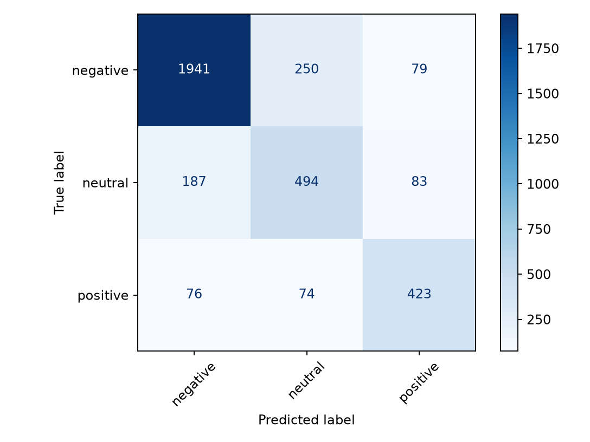
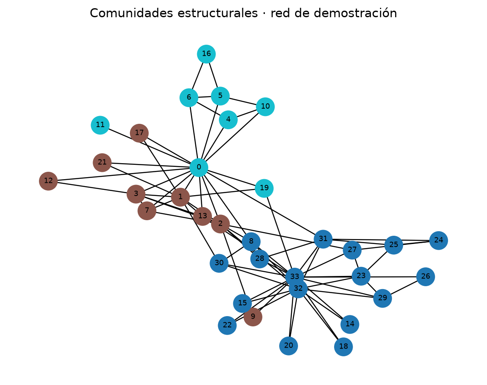

# INF-8239 · Unidad 02 · Proyecto de Procesamiento de Lenguaje Natural (PLN)

> **Autor académico del diseño base:** Edwin Ramón José Nolasco  
> **Adaptación del laboratorio:** Clasificación de Sentimientos y Análisis Semántico sobre *Twitter US Airline Sentiment*

---

## 1. Descripción del Proyecto y Dataset

Este proyecto implementa un flujo reproducible de Procesamiento de Lenguaje Natural (PLN) orientado a clasificar opiniones de pasajeros sobre aerolíneas comerciales en tres categorías de sentimiento: `negative`, `neutral` y `positive`.

* **Dataset adoptado:** [Twitter US Airline Sentiment](https://www.kaggle.com/datasets/crowdflower/twitter-airline-sentiment) (CrowdFlower / Kaggle).
* **Ficha Técnica Completa:** Consulte [docs/DATASET_CARD.md](docs/DATASET_CARD.md) para el diccionario de variables, licencias, calidad de datos y consideraciones éticas.
* **Resumen de Datos Auditados (`scripts/audit_data.py`):**
  * **Registros totales:** 14,640 filas y 15 columnas.
  * **Integridad (SHA-256):** `ea94b23f41892b290dec3330bb8cf9cb6b8bc669eaae5f3a84c40f7b0de8f15e`.
  * **Nulos en variables clave:** 0 en `text`, 0 en `airline_sentiment`.
  * **Duplicados:** 213 textos eliminados en preprocesamiento (14,427 tweets únicos).
  * **Distribución de clases (Desbalance):** Negativo: 62.7%, Neutral: 21.2%, Positivo: 16.1%.

---

## 2. Configuración del Entorno y Ejecución Rápida

El proyecto utiliza [`uv`](https://docs.astral.sh/uv/) para gestionar dependencias y entornos virtuales con Python 3.12.

### A. Preparación del archivo `.env`
El proyecto sigue el estándar de configuración desacoplada. Asegúrese de que el archivo `.env` en la raíz contenga:

```env
DATA_SOURCE=local
DATASET_PATH=data/raw/Tweets.csv
DATASET_URL=https://www.kaggle.com/datasets/crowdflower/twitter-airline-sentiment
TEXT_COLUMN=text
TARGET_COLUMN=airline_sentiment
RANDOM_STATE=42
```

### B. Comandos de Verificación Inicial

```bash
# 1. Instalar Python 3.12 y sincronizar dependencias
uv python install 3.12
uv sync

# 2. Ejecutar batería de pruebas unitarias (6 tests)
uv run pytest -q

# 3. Auditar contrato de datos e integridad
uv run python scripts/audit_data.py
```

---

## 3. Entrenamiento y Resultados Experimentales

Para entrenar los modelos de clasificación, evaluar métricas y generar artefactos visuales:

```bash
uv run python scripts/train_text.py
```

### A. Comparativa de Modelos (Evaluación en Test Set 25% Estratificado)

| Modelo | F1-Macro | Accuracy | Precisión Ponderada | Recall Ponderado | Rol Experimental |
| :--- | :---: | :---: | :---: | :---: | :--- |
| **DummyClassifier** | **0.258** | 0.63 | 0.40 | 0.63 | **Control / Línea Base Ingenua:** Asigna siempre la clase mayoritaria (`negative`). Demuestra por qué el *Accuracy* es engañoso en clases desbalanceadas. |
| **Naive Bayes (ComplementNB)** | **0.550** | 0.72 | 0.76 | 0.72 | **Modelo Probabilístico:** Optimizado para texto desbalanceado. Excelente precisión en positivos y neutrales, pero bajo recall en neutros. |
| **Logistic Regression (balanced)** | **0.741** | **0.79** | **0.80** | **0.79** | **Modelo Seleccionado:** Vectorización TF-IDF (unigramas y bigramas) con ponderación balanceada de clases. Logra el mejor equilibrio general. |

### B. Matriz de Confusión (Modelo Seleccionado: Regresión Logística)

La siguiente matriz evidencia la capacidad del modelo para distinguir las tres clases y revela que la mayor fricción se presenta entre opiniones neutrales y negativas:



### C. Análisis de Errores Cualitativos
El archivo [reports/error_analysis.csv](reports/error_analysis.csv) compila los 764 casos de prueba donde el modelo discrepó de la etiqueta humana. Los patrones de error principales corresponden a:
1. **Sarcasmo e ironía:** Tweets como *"Thanks for leaving my luggage behind, fantastic flight"* clasificados erróneamente como positivos debido a palabras como *"thanks"* y *"fantastic"*.
2. **Ambigüedad neutral vs. negativa:** Consultas sobre demoras en puerta que los anotadores marcaron como neutrales, pero el clasificador asoció a quejas.

---

## 4. Análisis Semántico (Word2Vec) y Redes de Grafos

El script `scripts/embeddings_network.py` entrena un modelo de representación densa (*Word Embeddings*) sobre los tweets y genera métricas de centralidad y comunidades:

```bash
uv run python scripts/embeddings_network.py --word flight --network-demo
```

### A. Semántica Aprendida (Vecinos más cercanos a `"flight"`):
* **Vocabulario:** 15,051 términos únicos.
* **Términos más similares:** `flt` (similitud 0.640), `connection` (0.634), `flights` (0.602), `departure` (0.541), `ticket` (0.540), `trip` (0.519), `rebooked` (0.495).  
* **Conclusión semántica:** El espacio vectorial capturó con alta fidelidad las relaciones contextuales y jerga aeroportuaria sin intervención manual de sinónimos.

### B. Grafo de Comunidades Estructurales

El análisis estructural de modularidad identificó 3 comunidades de alta densidad (modularidad = 0.411):



Las métricas de centralidad (Grado, Betweenness, PageRank) se encuentran documentadas en [reports/centralities.csv](reports/centralities.csv).

---

## 5. Demostración Interactiva con Streamlit

El modelo seleccionado y serializado en [models/text_model.joblib](models/text_model.joblib) puede ejecutarse interactivamente mediante la interfaz web:

```bash
uv run streamlit run app/streamlit_app.py
```

### Casos de Prueba Sugeridos para la Demostración

Copie y pegue estos ejemplos en el área de texto de la aplicación para validar el comportamiento del clasificador:

| # | Texto del Tweet de Prueba (Inglés) | Traducción al Español | Clase Esperada | Justificación Lingüística |
|---|---|---|:---:|---|
| **1** | `"Our flight was cancelled with zero notice and customer service was extremely rude! Never flying with you again."` | *Nuestro vuelo fue cancelado sin aviso y el servicio al cliente fue sumamente grosero. Nunca volveré a volar con ustedes.* | **`negative`** | Fuertes n-gramas negativos: *"cancelled"*, *"zero notice"*, *"extremely rude"*. |
| **2** | `"Incredible flight! The flight attendants were super friendly and we landed 25 minutes ahead of schedule. Thank you!"` | *¡Vuelo increíble! Los asistentes de vuelo fueron súper amables y aterrizamos 25 minutos antes de lo previsto. ¡Gracias!* | **`positive`** | Polaridad positiva explícita: *"incredible"*, *"super friendly"*, *"thank you"*. |
| **3** | `"Flight 402 from Boston to Dallas is scheduled to depart at gate B12 tomorrow at 8:30 AM."` | *El vuelo 402 de Boston a Dallas está programado para salir en la puerta B12 mañana a las 8:30 AM.* | **`neutral`** | Lenguaje factual y operativo sin carga emocional subjetiva. |

---

## 6. Marco de Interpretación de Resultados

En conformidad con las directrices académicas de la asignatura:

1. **Observación:** La Regresión Logística con TF-IDF alcanzó un F1-macro de **0.741** y un Accuracy global de **79%**, superando holgadamente a la línea base ingenua (F1 = 0.258) y al clasificador Naive Bayes (F1 = 0.550).
2. **Evidencia:** La matriz de confusión demuestra una sensibilidad del 86% para la clase negativa (2,270 muestras de prueba) y del 74% para la positiva, con un F1 de 0.62 en la clase neutral.
3. **Interpretación:** El desbalance del 62.7% en contra de quejas no impidió un rendimiento balanceado gracias a la ponderación por clases inversas (`class_weight="balanced"`). No obstante, los errores en tweets neutrales reflejan la dificultad inherente de TF-IDF para captar sutilezas contextuales y preguntas operativas sin marcadores afectivos explícitos.
4. **Decisión:** Para un despliegue operativo en monitoreo de atención al cliente, se adopta el modelo de Regresión Logística como filtro de triaje automático para enrutar quejas urgentes a agentes humanos, manteniendo supervisión manual sobre casos neutrales o limítrofes.
